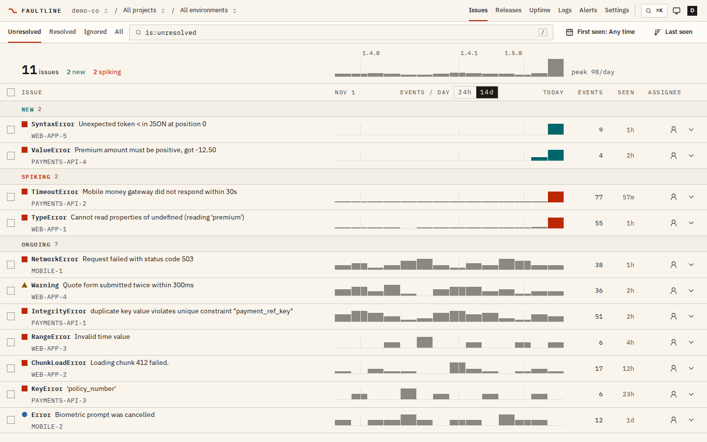
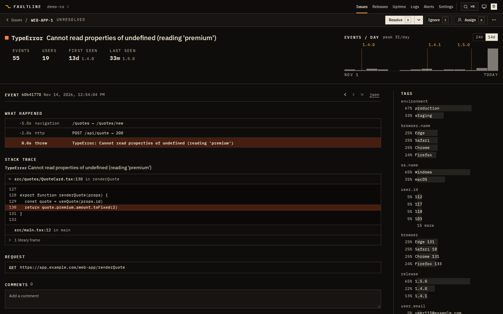
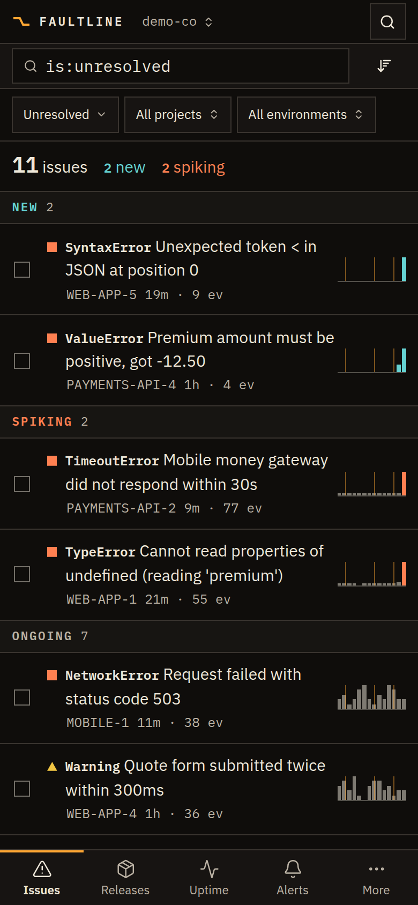
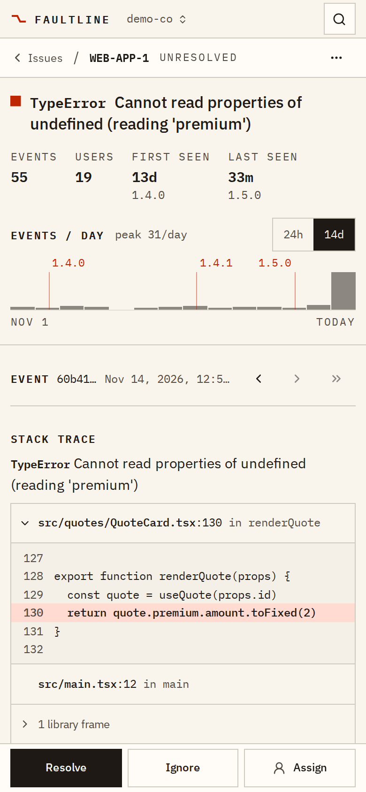

# Faultline

**A modern frontend for self-hosted [GlitchTip](https://glitchtip.com).** Issues, uptime monitors, performance, logs, releases, alerts, settings and sign-in in one fast, keyboard-first app that works on your phone. It is built to replace the stock UI entirely, and runs against an unmodified GlitchTip backend.

Faultline is an independent project and is not affiliated with or endorsed by GlitchTip.

<picture>
  <source media="(prefers-color-scheme: dark)" srcset="docs/screenshots/inbox-1440-dark.png">
  
</picture>



<p>
  
  
</p>

## Why

GlitchTip is a great open-source, Sentry-compatible error tracker. Faultline gives it a dense, fast interface built for daily triage:

- **Keyboard first:** `j`/`k` to move, `x` to select, `e` to resolve, `/` to search, `⌘K` for everything else.
- **See what's new and spiking at a glance:** every issue sits on one shared timeline, with release markers.
- **A full replacement:** the goal is every screen of the stock UI, tracked in [the parity checklist](docs/parity.md), so you never need to switch back.
- **Works on a phone:** triage an alert from wherever you are.
- **Light and dark** themes.
- **Drop-in:** one container in front of your existing GlitchTip. Old alert and email links keep working because Faultline uses the same URLs.

## Quick start

Faultline is one image: it serves the app and passes API, sign-in and ingest requests through to GlitchTip on the same origin, so sessions keep working.

```sh
docker run -d -p 8080:8080 -e BACKEND_URL=http://your-glitchtip:8000 ghcr.io/snnbotchway/faultline
```

Open http://localhost:8080 and sign in with your GlitchTip account.

### Next to GlitchTip in Docker Compose

Add a service to the Compose file that runs GlitchTip, and point your reverse proxy (or users) at Faultline instead of GlitchTip:

```yaml
services:
  faultline:
    image: ghcr.io/snnbotchway/faultline:latest
    environment:
      BACKEND_URL: http://web:8000   # the GlitchTip web service
    ports: ["8080:8080"]
    restart: unless-stopped
```

Set GlitchTip's `GLITCHTIP_DOMAIN` to Faultline's public URL, so the links in alerts and emails open Faultline. Your SDKs can keep their DSNs: Faultline also passes event ingest through to GlitchTip.

## Configuration

| Variable | Default | Meaning |
|---|---|---|
| `BACKEND_URL` | (required) | Where the GlitchTip web service listens, as Faultline's container sees it, e.g. `http://glitchtip:8000`. |
| `PORT` | `8080` | Port Faultline listens on inside the container. |

Performance needs GlitchTip's cold storage for span breakdowns, weekly trends and repeated queries: set `GLITCHTIP_ENABLE_DUCKDB=true` and `GLITCHTIP_COLD_STORAGE_DIR` (on a volume) or a storage bucket on the GlitchTip service. Without it the screens ask users to have an admin turn on "request details". See [docs/compatibility.md](docs/compatibility.md#cold-storage-for-performance).

Behind a TLS proxy that forwards the original `Host` header (Caddy, Traefik, Tailscale Serve, most nginx setups), nothing else is needed. If your proxy rewrites `Host`, add Faultline's URL to GlitchTip's `CSRF_TRUSTED_ORIGINS`.

## Compatibility

Faultline is tested in CI against real GlitchTip backends. See [docs/compatibility.md](docs/compatibility.md) for the tested versions.

| Faultline | GlitchTip |
|---|---|
| 0.1.1 | 7.0.0 |
| 0.1.0 | 7.0.0 |

## Status

Faultline is young. [docs/parity.md](docs/parity.md) lists every screen and feature of the stock GlitchTip UI and which ones Faultline covers so far.

## Develop

```sh
bun install
bun run backend:up && bun run seed:performance   # GlitchTip 7.0.0 with demo issues, transactions and logs on :8600
bun run dev                                      # http://localhost:5190, demo@example.com / demo-pass-123
```

See [CONTRIBUTING.md](CONTRIBUTING.md). Coding agents: start with [AGENTS.md](AGENTS.md) or [llms.txt](public/llms.txt).

## Licence

[MIT](LICENSE). The vendored API schemas come from GlitchTip and django-allauth, both MIT; see [src/api/schema/NOTICE.md](src/api/schema/NOTICE.md).
